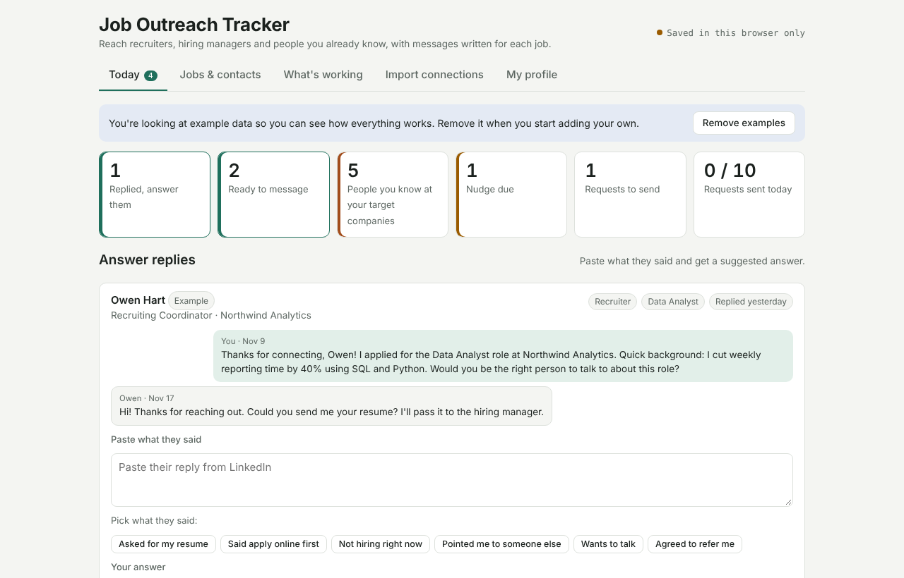
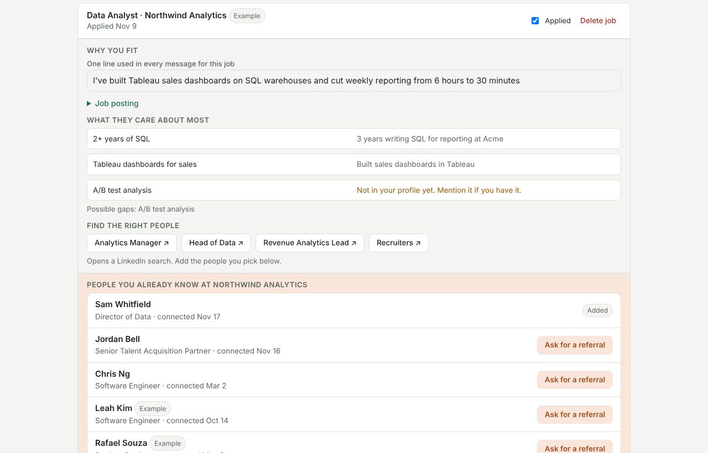
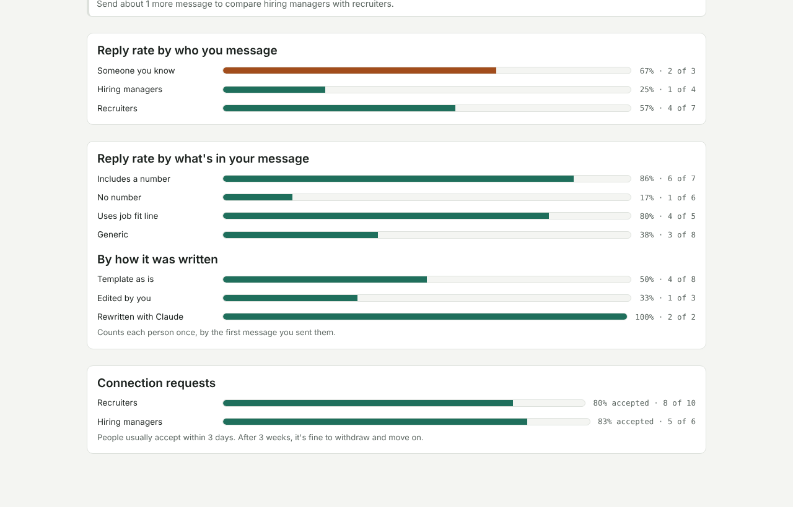

# Job Outreach Tracker

A single-page tool for reaching recruiters, hiring managers and people you already know on LinkedIn, with messages written for each job, follow-up reminders, and stats on what gets replies.

It never touches your LinkedIn account. It drafts and tracks; you send each message yourself in a few seconds. Bots that auto-send connection requests or messages break LinkedIn's User Agreement and can get accounts restricted, so this tool doesn't do that.

▶️ **[Watch the 1-minute demo](docs/demo.mp4)**

## What it does

- **Today queue.** One list of what to do next: replies to answer, people who just accepted, nudges due, and connection requests to send.
- **Warm paths.** Import your LinkedIn connections file and see everyone you already know at each company you're targeting. One click drafts a referral request.
- **Job posting analysis.** Paste a job description and Claude picks out the top requirements, matches them to your experience, flags gaps, and writes a one-line "why I fit" that goes into every message for that job. It also suggests hiring-manager titles to search for.
- **Tailored drafts.** Connection notes, post-accept messages, referral asks and nudges, each written differently for recruiters, hiring managers and people you know. Character counters keep connection notes short enough to send.
- **Reply coach.** Paste what someone wrote back and get a suggested answer that fits the conversation so far. Six built-in replies cover common situations, such as "send your resume" or "not hiring right now".
- **What's working.** Your own reply rates by who you contacted and what was in the message (a number or not, your job fit line or generic, template or rewritten), plus connection acceptance rates.
- **Import acceptances.** Drop in LinkedIn's `Connections.csv` and pending requests that were accepted are marked automatically. New recruiters and managers you connected with are suggested to track.

## Run it

It's one HTML file with no build step and no server.

- **Locally:** open `index.html` in a browser.
- **GitHub Pages:** in the repo's Settings → Pages, choose "Deploy from a branch", pick `main` and `/ (root)`, and save.

### Where data is stored

| Where it runs | Storage | Claude features |
| --- | --- | --- |
| As a Claude artifact on claude.ai | Private to your Claude account, synced across devices | Rewrite with Claude, posting analysis and reply coach |
| Anywhere else (local file, GitHub Pages) | Your browser's `localStorage` only | Hidden. Built-in templates and the six reply options still work |

Your connections file is read in the browser and never sent to LinkedIn or any other server.

## Get your LinkedIn connections file

1. On LinkedIn, open **Settings & Privacy → Data privacy → Get a copy of your data**.
2. Choose the specific-data option, tick **Connections**, and request the archive.
3. When LinkedIn emails you, download and unzip it, then drop `Connections.csv` into the **Import connections** tab.

## Tips that the tool is built around

- Start from a real opening, not a job title. Connect with the recruiter and the hiring manager for that role.
- Ask people you already know at the company for a referral first.
- Put one specific result with a number in your messages.
- Follow up once after about a week, then move on.
- About 10 well-chosen requests a day beats 50 generic ones.
